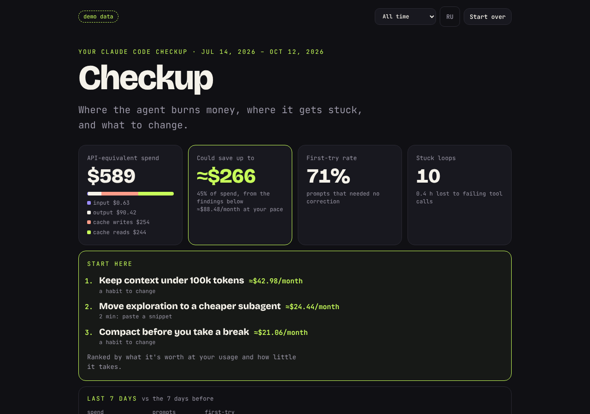
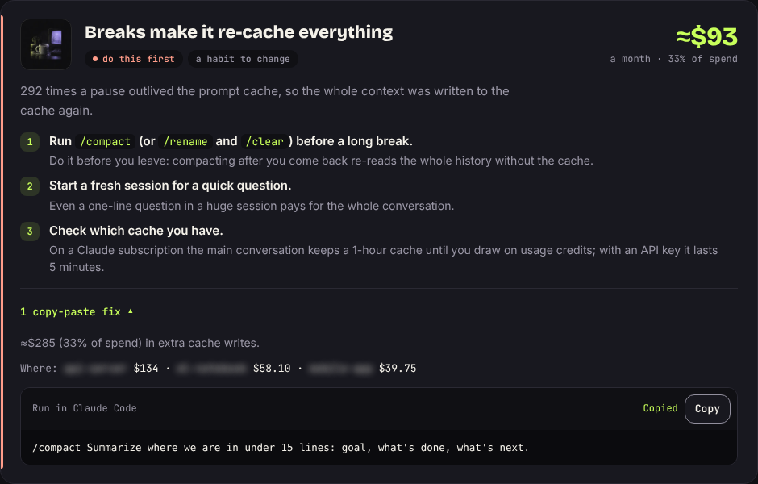
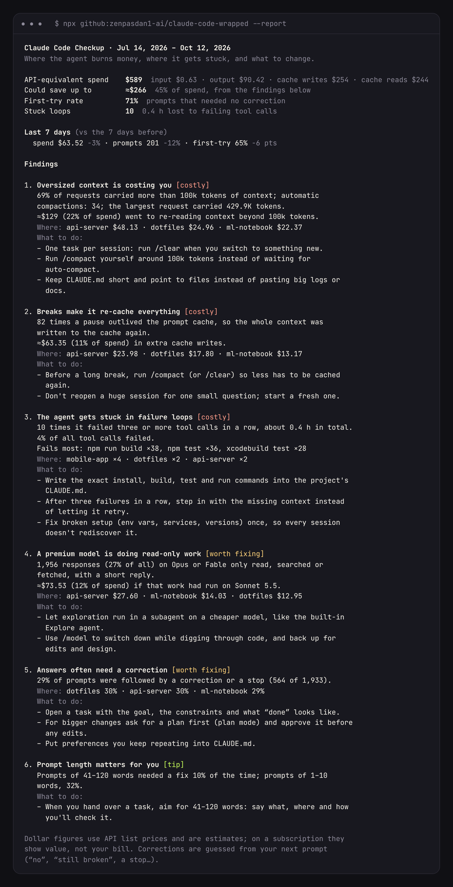
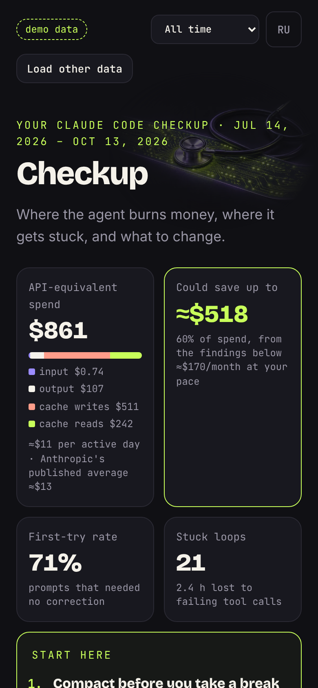
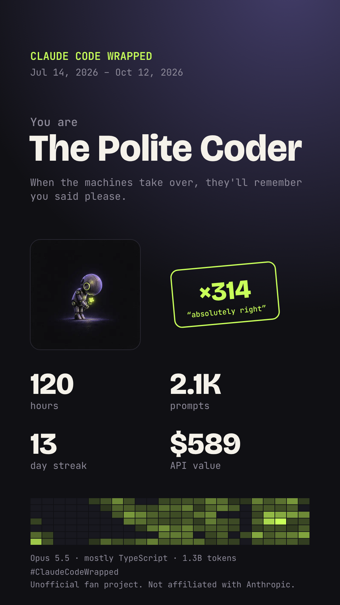

https://github.com/user-attachments/assets/7b674cac-1461-420c-8452-7114e714664e

# Claude Code Wrapped

[](https://github.com/zenpasdan1-ai/claude-code-wrapped/actions/workflows/ci.yml)
[](LICENSE)

**A checkup for your Claude Code habits.** It reads the transcripts Claude Code already keeps
in `~/.claude/projects` and tells you, in dollars, what oversized context, cache misses and
the wrong model cost you, where the agent gets stuck, and what to change. Then it gives you a
Wrapped story to share. Everything runs on your machine. Unofficial, not affiliated with Anthropic.

```sh
npx github:zenpasdan1-ai/claude-code-wrapped            # checkup + Wrapped in the browser
npx github:zenpasdan1-ai/claude-code-wrapped --report   # checkup in the terminal
```



On a real two-day session that built this project (and four other projects before it, all in one
session), the checkup found that about a fifth of the API-equivalent spend went to re-reading earlier,
unrelated work after coming back from breaks, and another fifth to re-caching the whole context after
breaks longer than the cache lasts. Both have a one-line fix: `/clear` between tasks.

## What the checkup finds

| Finding | How it's measured | What it tells you to do |
| --- | --- | --- |
| **Old tasks riding along** | Coming back to a session after an hour or more with 50k+ tokens of earlier work, and re-reading it on every request after that (until a compaction), minus what a fresh start costs. A big context on its own is not a finding: a hard task needs it | `/rename` → `/clear` → `/resume` between tasks, `/compact` with what to keep, a `# Compact instructions` section, `CLAUDE.md` under 200 lines |
| **Re-caching after breaks** | Requests that wrote 20k+ tokens to the cache after a pause longer than its lifetime (5 min, or 1 h for the 1-hour cache). On the 5-minute cache it also weighs the 1-hour TTL: pricier writes against the rewrites it avoids | `/compact` before you leave, not after; start fresh instead of reopening a huge session; `"promptCacheTtl": "1h"` when it pays off |
| **Premium model on read-only work** | Opus/Fable responses that only read, searched or fetched with a short reply, re-priced on Sonnet 5.5 | A read-only subagent on Sonnet or Haiku (the built-in Explore uses your main model); choose the model at session start, since every `/model` switch re-reads the conversation uncached |
| **Failure loops** | Three or more failed tool calls in a row, time until the next success, the commands that fail most | Exact build/test commands in `CLAUDE.md`, a check Claude can run, Esc to redirect early, single tests over the whole suite |
| **Corrections** | Prompts followed by a correction (“no”, “still broken”, “не то”…) or a stop, per project | Say how to check “done”; plan mode (Shift+Tab) for big changes; let Claude interview you; `/clear` after two failed corrections; double Esc or `/rewind` to step back |
| **Prompt length** | Correction rate by prompt length, shown only when the gap is large enough to trust | The length that works for you, with Goal / Where / Constraints / Check |

The advice follows Claude Code's own documentation: [context window](https://code.claude.com/docs/en/context-window),
[prompt caching](https://code.claude.com/docs/en/prompt-caching), [costs](https://code.claude.com/docs/en/costs),
[best practices](https://code.claude.com/docs/en/best-practices), [subagents](https://code.claude.com/docs/en/sub-agents)
and [checkpointing](https://code.claude.com/docs/en/checkpointing).

Findings are **ranked for you**: *do this first*, *worth doing*, or *minor* (collapsed), by what
they're worth at your own usage (dollars per month, hours stuck, how often answers miss) and how
little work the fix takes. A **Start here** list puts the top three at the top with their value
and effort, so you know what to do and what to skip.

Each finding comes with a **copy-paste fix**: a short `CLAUDE.md` section (your project's own
failing commands, ready to fill in; rules for when something fails; how to work with you), a
read-only `explorer` subagent on Sonnet for `.claude/agents/`, a `/compact` command that says what
to keep, or a task template. The shared sections are also collected into one block to paste.
They're short on purpose: `CLAUDE.md` is sent with every request.



Each finding names the projects it comes from (blurred on screen until you reveal them).
Things that look fine are listed too. A **last 7 days vs the 7 before** strip shows whether
your spend, prompt count and first-try rate are moving the right way, so it's worth re-running
weekly: `npx github:zenpasdan1-ai/claude-code-wrapped --report --days 7`.

<p align="center">
  
  &nbsp;
  
</p>

## And your Wrapped

<p align="center">
  
  &nbsp;&nbsp;
  
</p>

Hours with the agent, prompts, how many times Claude said “You're absolutely right”, model mix,
weekday × hour heatmap, streaks, tools, the languages it edited for you, your priciest day, and an
archetype (Night Owl, Polite Coder, Opus Maximalist…) with its own illustrated portrait. Every
slide sits on an illustrated background. Share it as a 1200×675 post card or a 1080×1920 story
card; both carry your archetype's portrait.


## Ways to run it

- **One command** (Node 18.17+): `npx github:zenpasdan1-ai/claude-code-wrapped`. It finds
  `$CLAUDE_CONFIG_DIR/projects`, `~/.claude/projects` or `~/.config/claude/projects`, serves the
  page on `127.0.0.1` and opens it. Pass a folder to read somewhere else. Options: `--report`,
  `--days <n>`, `--lang ru`, `--port <n>`, `--no-open`.
- **In the browser**: open the [site](https://zenpasdan1-ai.github.io/claude-code-wrapped/) and choose
  `~/.claude/projects` (on macOS press ⌘⇧. to show hidden folders), pick `.jsonl` files, or drop the folder.
- **Just looking**: the [demo checkup](https://zenpasdan1-ai.github.io/claude-code-wrapped/#demo) and the
  [demo story](https://zenpasdan1-ai.github.io/claude-code-wrapped/#demo-story) use generated data.

Every period works: all time, this year, the last 90 or 30 days. The interface is in English, with
Russian one click away.


## Privacy

- The page reads files with the browser's File API. Nothing is uploaded and there is no analytics.
- The CLI listens on `127.0.0.1` only. Its transcript routes need a random one-time token from the
  link it prints and refuse other host names, so other sites can't read them.
- Only counts are kept. Commands are reduced to the tool and script name (`npm run build`), file paths
  to their extension, and project names are blurred until you choose to show them. Cards never include them.

## How it counts

| Number | Source |
| --- | --- |
| Prompts | `type: "user"` lines with typed text; tool results, `isMeta` lines (skills, hook feedback), slash commands, notices and interrupts are excluded |
| Tokens and cost | `message.usage`, once per API response (`message.id` + `requestId`); content blocks, which Claude Code writes one per line, are counted by their own ids |
| Spend | API list prices from Anthropic's pricing page; cache writes at 1.25× input (2× for the 1-hour cache), cache reads at 0.1× (0.05× on Opus 5.5 and Sonnet 5.5, 0.025× on Fable 5.1), Haiku 5.5's higher tier for prompts over 100k. Shown per active day next to Anthropic's published average of about $13 |
| Active time | Gaps between events in a session, ignoring gaps over 30 minutes |
| Projects | The folder a session started in; the agent's later `cd`s don't move it |
| Corrections | The next prompt in the same session starts with pushback or the turn was stopped; a heuristic in English and Russian |

Dollar figures are estimates of value at list prices, not a bill; on a subscription they show what
the same usage would cost on the API. Savings are upper bounds and overlap only slightly.

## Develop

```sh
npm start        # the site at http://127.0.0.1:8080 (#demo, #demo-story)
npm test         # parser, pricing, checkup, stats, CLI and server tests (node:test, no dependencies)
node bin/ccwrapped.mjs --help
```

No build step and no dependencies: plain ES modules, Canvas 2D for the cards, Node's standard library
for the CLI. Pushing to `main` runs the tests on Node 18, 20 and 22 and publishes the site to GitHub Pages.

## Prior art

Transcript parsing ideas follow open-source tools such as [ccusage](https://github.com/ryoppippi/ccusage)
(MIT), which tracks usage and cost; this project focuses on what to change. No code is copied.
