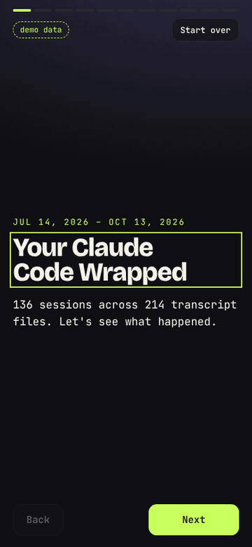
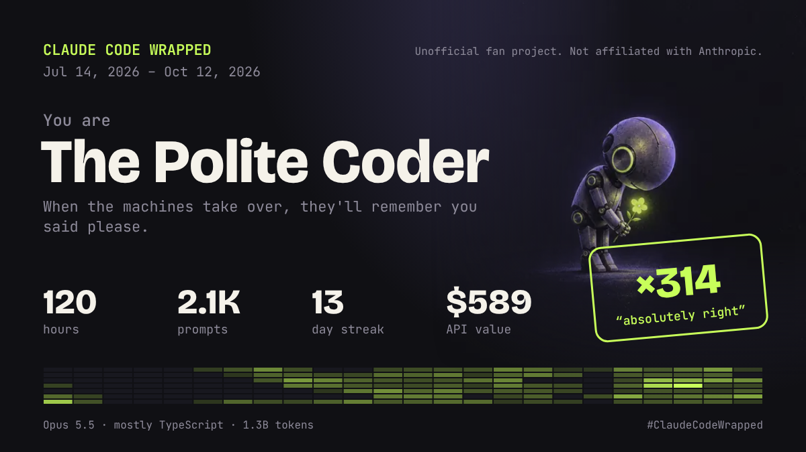
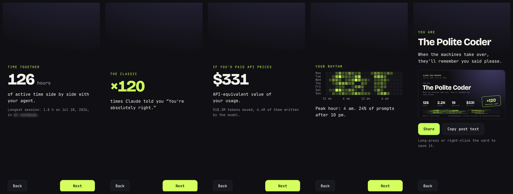
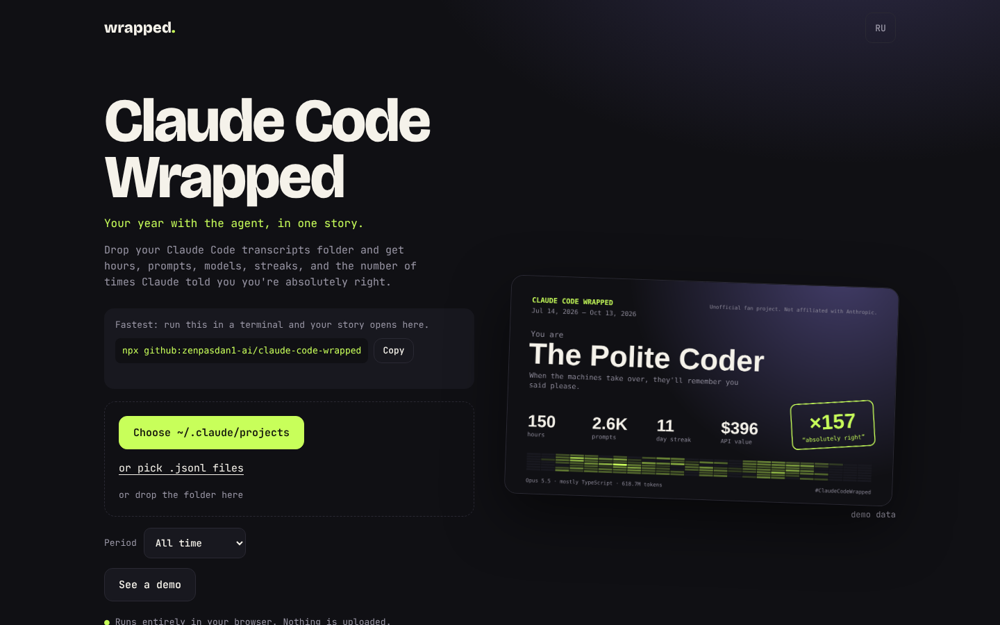

# Claude Code Wrapped

A Spotify-Wrapped-style story of your time with Claude Code, built from the transcripts
Claude Code already keeps in `~/.claude/projects`. Everything runs in the browser:
files are read locally and only counts are kept. Unofficial fan project, not affiliated
with Anthropic.

<p align="center">
  
  &nbsp;&nbsp;
  
</p>

Every screenshot here uses the built-in demo data. Open the page with `#demo` at the end
of the URL (for example `http://127.0.0.1:8080/#demo`) to jump straight into the sample story
without any transcripts. A video of the same walkthrough is in [`docs/demo.mp4`](docs/demo.mp4).





All 11 slides at phone size are in [`docs/slides`](docs/slides).

## What it shows

- Active hours with the agent (idle gaps over 30 minutes are not counted), sessions, longest session
- Prompts you typed, plus how often you wrote “please”, “thanks”, and words we won't print
- How many times Claude said “You're absolutely right”
- API-equivalent value of your usage (list prices; see `js/pricing.js`)
- Model mix, weekday × hour heatmap, longest streak, top tools, top projects (names blurred until you reveal them)
- An archetype (Night Owl, Polite Coder, Opus Maximalist…) and a 1200×675 card for posting

## Run

```sh
npm start        # http://127.0.0.1:8080
npm test         # parser, pricing and stats tests (node:test, no dependencies)
```

Choose `~/.claude/projects` in the page (on macOS press ⌘⇧. to show hidden folders),
pick `.jsonl` files, or drop the folder onto the page. “See a demo” uses generated data.

## How it counts

| Number | Source |
| --- | --- |
| Prompts | `type: "user"` lines with typed text; tool results, slash commands and interrupts are excluded |
| Tokens and cost | `message.usage` on assistant lines, de-duplicated by `message.id` + `requestId` (streaming writes repeats) |
| Active time | Gaps between consecutive events in a session, each gap capped out if longer than 30 minutes |
| Streak | Consecutive local calendar days with at least one prompt |

Prices are API list prices per million tokens; cache writes at 1.25× input and cache
reads at 0.1× input unless a model publishes its own cache-read price. Rows marked
`legacy` are older published prices so old transcripts still count. It is an
estimate of value, not a bill.

## Prior art

Transcript parsing ideas (dedupe by message and request id, cost from usage fields) follow
open-source tools such as [ccusage](https://github.com/ryoppippi/ccusage) (MIT). No code is copied.
